<a name="english"></a>

<p align="center">
  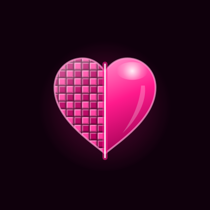
</p>

<h2 align="center">KARTUN</h2>

<p align="center">
  <a href="#english"></a>
  &nbsp;
  <a href="#russian"></a>
</p>

<p align="center"><b>Krinik Android Restoration Tool for Upscaling with Neural Networks</b><br>
Open source · Offline · AI on the device</p>

<p align="center">
  <a href="LICENSE"></a>
  <a href="https://github.com/Tencent/ncnn"></a>
  <a href="#en-3"></a>
  <a href="#en-3"></a>
  <a href="#en-5"></a>
  <a href="#en-1"></a>
  <a href="#en-8"></a>
  <a href="https://github.com/MikalaiKryvusha/KAIF"></a>
</p>

[Читать по-русски →](#russian)

**KARTUN** makes a small or blurry photo big and sharp with a neural network, right on an Android phone or tablet. Pick
a photo, tap one button, drag the line across the picture to compare before and after, then save the result or send it
on. The picture never leaves the device: the network runs on the phone's graphics chip through Vulkan.

<p align="center">
  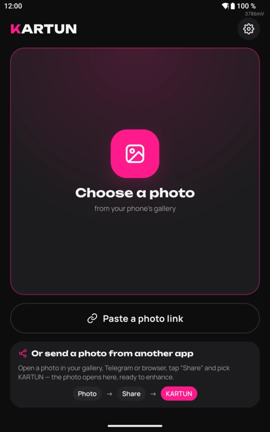
  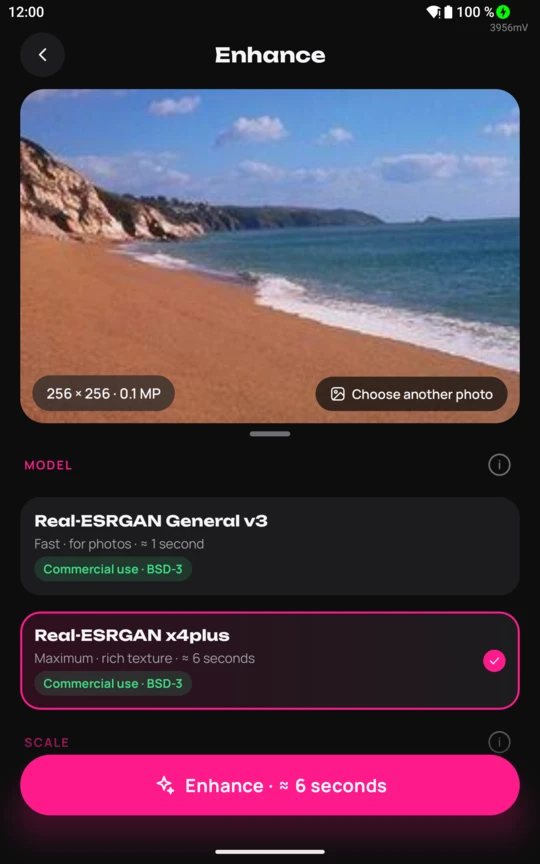
  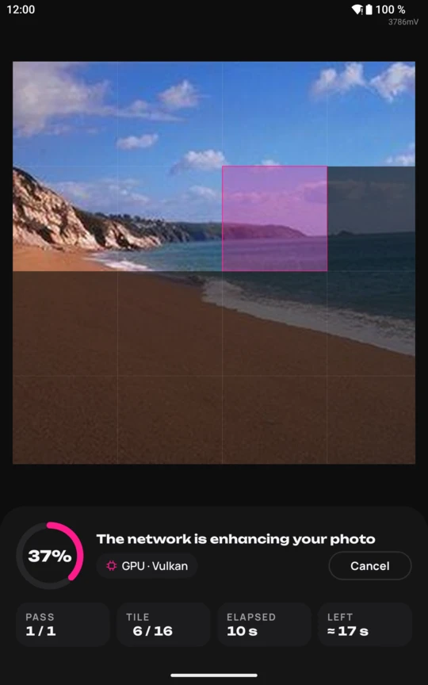
  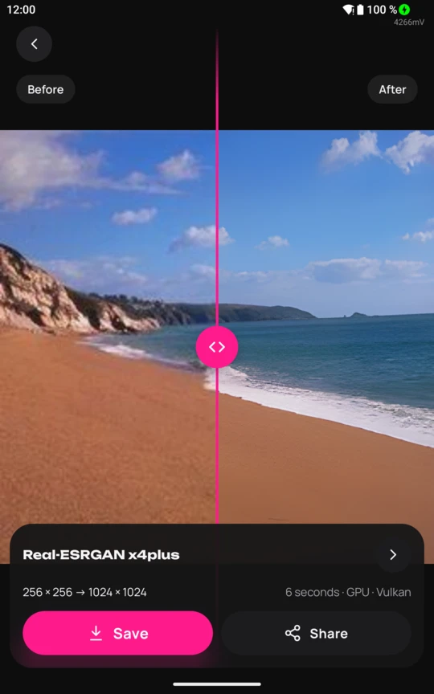
  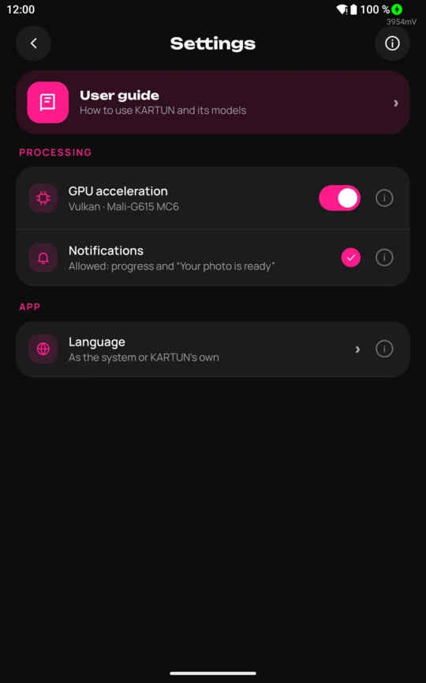
</p>

Sections: [1 What it does](#en-1) · [2 Screens](#en-2) · [3 Models and speed](#en-3) · [4 Privacy](#en-4) · [5 Formats and limits](#en-5) · [6 Build](#en-6) · [7 Project map](#en-7) · [8 Status and plans](#en-8) · [9 Credits and licence](#en-9).

<a name="en-1"></a>
### 1. What it does

1. Enlarges a photo 1×, 2×, 4×, 8× or 16× with a Real-ESRGAN neural network. The network restores detail that plain
   stretching does not have: edges, texture, small text.
2. Takes the photo three ways: from the gallery, from any app's «Share» menu (Telegram, the gallery, a browser), or from
   a link — taken from the clipboard or typed in.
3. Estimates the time before the run and shows the progress as a percent ring over the photo's real tiles. The estimate
   learns from the runs on your device.
4. Keeps working when you leave the app: the progress and «Cancel» stay in the notification, «Your photo is ready»
   comes when it is done.
5. Compares before and after over the whole screen: drag the pink line, move the photo with a finger, double-tap to
   zoom in, pinch to zoom further. The panel with the buttons slides away to the edge.
6. Saves into `Pictures/KARTUN` as PNG, JPEG or WebP with a quality slider, always as a new file, or sends the result
   through the system «Share» menu.
7. Speaks ten languages: English, Russian, Spanish, Portuguese, French, German, Chinese, Hindi, Bengali, Arabic. The
   language follows the system or is chosen for KARTUN alone.
8. Works in portrait and landscape; every setting has an (i) button with a short explanation, and the user guide is
   built in.
9. Takes jobs from AI agents on a PC over adb: `node tools/kartun-cli.mjs upscale photo.jpg` sends the photo to the
   device and brings the result back, even while KARTUN is closed. The commands and the JSON responses are in
   [docs/agent-api.md](docs/agent-api.md).

<a name="en-2"></a>
### 2. Screens

| Screen | What you do there |
|---|---|
| Home | pick a photo, paste a link, or read how to send a photo from another app |
| Enhance | see the photo and its size, pick the model and the scale, start; swipe up to fold the photo into a row, pull the handle down to open it full screen |
| Processing | watch the ring and the tiles fill in, see the time spent and the time left, cancel |
| Result | compare before and after, save, share |
| Settings | GPU acceleration, notifications, language, the user guide, «About» with the device, the author and the licences, the terms of use |

<p align="center">
  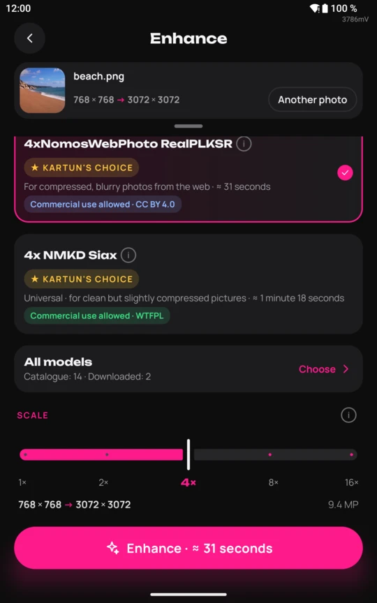
  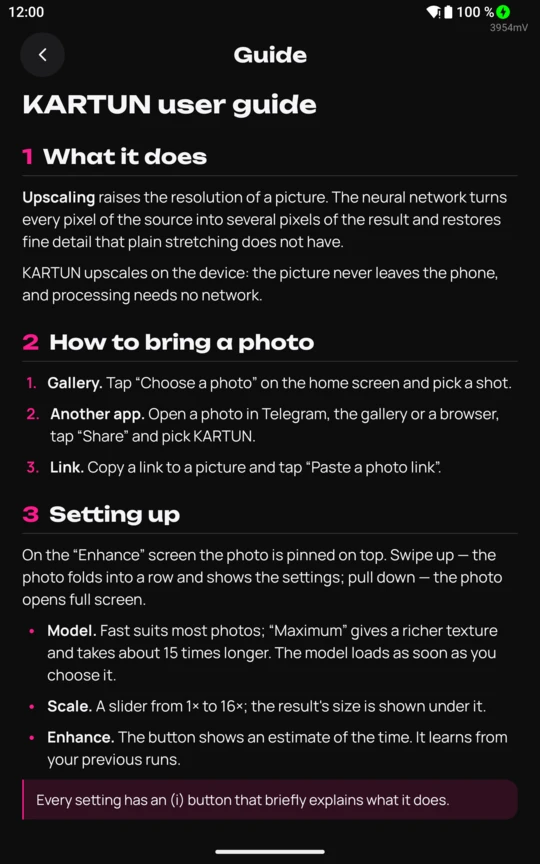
  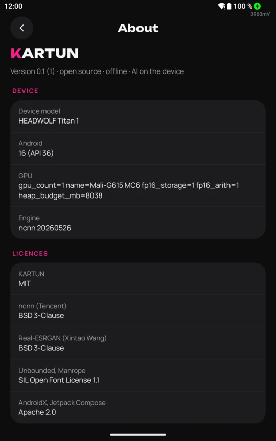
</p>

<a name="en-3"></a>
### 3. Models and speed

Two models ship inside the app and work without the network:

| Model | What it is for | Licence | 256 × 256 → 1024 × 1024 |
|---|---|---|---|
| 4xNomosWebPhoto RealPLKSR by Philip Hofmann (default) | photos from the web: compression and blur | CC BY 4.0 | 4.3 s |
| 4x NMKD Siax by NMKD | universal: clean or slightly compressed pictures | WTFPL | 6.9 s |

Twelve more download in the app from the «All models» screen, each with a before/after example, its author, licence and
size: Real-ESRGAN General v3, x4plus, x4plus anime and AnimeVideo v3, 4xNomos8kSC, 4xHFA2k,
NMKD Superscale, ClearReality V1, Remacri, UltraMix Balanced, UltraSharp V2 Lite and UltraSharp V2. The files come from
this repository's [models release](https://github.com/MikalaiKryvusha/KARTUN/releases/tag/models), and the app checks
every file's SHA-256 before using it. The models belong to their authors; licences and sources are in
[docs/model-licenses.md](docs/model-licenses.md).

Measured on a HEADWOLF Titan 1 tablet: MediaTek MT8792, Mali-G615 MC6 graphics, Vulkan 1.3, Android 16. A 960 × 1280
photo enlarged 8× by ClearReality V1 takes 25 s.

KARTUN also runs a transformer: 4x UltraSharp V2 by Kim2091, a DAT2 network, works entirely on the graphics chip through
Vulkan. Its output differs from the original PyTorch network by 66.6 dB PSNR; the 960 × 1280 photo takes about 29
minutes. On the way we found an out-of-bounds read in an ncnn attention shader and sent the fix upstream
([Tencent/ncnn#7121](https://github.com/Tencent/ncnn/pull/7121)).

<a name="en-4"></a>
### 4. Privacy

1. The neural network runs on the device. No photo is uploaded anywhere.
2. The network permission is used for one thing only: downloading a picture from a link you paste.
3. No account, no ads, no analytics, no telemetry.
4. The original is never changed: every result is a new file.

<a name="en-5"></a>
### 5. Formats and limits

| | |
|---|---|
| Input | what Android itself opens (JPEG, PNG, WebP, HEIC, AVIF, GIF, BMP, ICO) plus TGA, PSD, PPM/PGM, HDR, QOI and TIFF |
| Output | PNG (lossless), JPEG and WebP with a quality slider; a result wider than WebP's 16 383 px or JPEG's 65 500 px per side is offered reduced to fit |
| Largest input photo | 200 MP |
| Largest result | 536 MP |
| 8× and 16× | two passes of the network: four to sixteen times longer than 2×–4× |
| Translations | English and Russian are written by hand; the other eight are AI translations checked by the author |

<a name="en-6"></a>
### 6. Build

There are no ready APKs yet; build the app from source on Windows. You need JDK 21, the Android SDK with platform 36,
NDK `29.0.14206865` and CMake `3.31.6`, Node.js and Python 3.

```powershell
git clone https://github.com/MikalaiKryvusha/KARTUN.git
cd KARTUN
node tools/fetch-ncnn.mjs                     # ncnn 20260526 for Android with Vulkan, hash-checked
```

Put the two models in place (sources and hashes: [docs/model-licenses.md](docs/model-licenses.md)):

1. Download `realesrgan-ncnn-vulkan-20220424-windows.zip` from the
   [Real-ESRGAN release v0.2.5.0](https://github.com/xinntao/Real-ESRGAN/releases/tag/v0.2.5.0) and unpack it into
   `engine/third_party/realesrgan-win/`.
2. Download `realesr-general-x4v3.pth` from the same release into `engine/third_party/` and convert it (Python with
   `torch`, `pnnx` and `numpy`):
   `python -I tools/convert-model.py engine/third_party/realesr-general-x4v3.pth engine/third_party/converted`

```powershell
node tools/stage-models.mjs                   # copies the models into the APK and checks every hash
.\gradlew.bat assembleDebug                   # app/build/outputs/apk/debug/app-debug.apk
```

<a name="en-7"></a>
### 7. Project map

| Path | What lives there |
|---|---|
| `app/` | the Android app: Kotlin, Jetpack Compose, the screens, the background service, saving and sharing |
| `engine/` | the native engine: C++ over ncnn behind one JNI boundary, tiles, Vulkan with a CPU fallback |
| `tools/` | build and test helpers: ncnn download, model conversion and staging, translations, the icon, device runs |
| `docs/` | licences of everything shipped, model provenance, the README screenshots |
| `design/` | the icon sources and the screen mockups |

<a name="en-8"></a>
### 8. Status and plans

Early development: the whole main path works on a real device, no public release yet. Next: a model catalogue with
downloadable models and preview pictures, writing very large results in strips, a release on GitHub. The roadmap is
[MASTER_PLAN.md](MASTER_PLAN.md), the current state is [STATUS.md](STATUS.md).

<a name="en-9"></a>
### 9. Credits and licence

1. [Upscayl](https://github.com/upscayl/upscayl) — the desktop app whose simplicity KARTUN follows. No Upscayl code is
   used: KARTUN's engine is written from scratch.
2. [Real-ESRGAN](https://github.com/xinntao/Real-ESRGAN) by Xintao Wang — the models (BSD-3).
3. [ncnn](https://github.com/Tencent/ncnn) by Tencent — the neural network engine (BSD-3).
4. [Unbounded](https://fonts.google.com/specimen/Unbounded) and [Manrope](https://fonts.google.com/specimen/Manrope) —
   the fonts (SIL Open Font License 1.1).
5. KARTUN is licensed under MIT ([LICENSE](LICENSE)); everything it ships is listed in
   [docs/THIRD_PARTY.md](docs/THIRD_PARTY.md). The project is run with [KAIF](https://github.com/MikalaiKryvusha/KAIF),
   a framework for work with an AI agent.

Author: Mikalai Kryvusha (Krinik).

---

<a name="russian"></a>

<p align="center">
  
</p>

<h2 align="center">KARTUN</h2>

<p align="center"><b>Krinik Android Restoration Tool for Upscaling with Neural Networks</b><br>
Открытый код · Без сети · ИИ на устройстве</p>

<p align="center">
  <a href="LICENSE"></a>
  <a href="https://github.com/Tencent/ncnn"></a>
  <a href="#ru-3"></a>
  <a href="#ru-3"></a>
  <a href="#ru-5"></a>
  <a href="#ru-1"></a>
  <a href="#ru-8"></a>
  <a href="https://github.com/MikalaiKryvusha/KAIF"></a>
</p>

[Read in English →](#english)

**KARTUN** делает маленькое или размытое фото большим и чётким с помощью нейросети прямо на Android-телефоне или
планшете. Выберите фото, нажмите одну кнопку, проведите линию по картинке, чтобы сравнить «до» и «после», затем
сохраните результат или отправьте дальше. Снимок не покидает устройство: нейросеть работает на видеочипе телефона через
Vulkan.

<p align="center">
  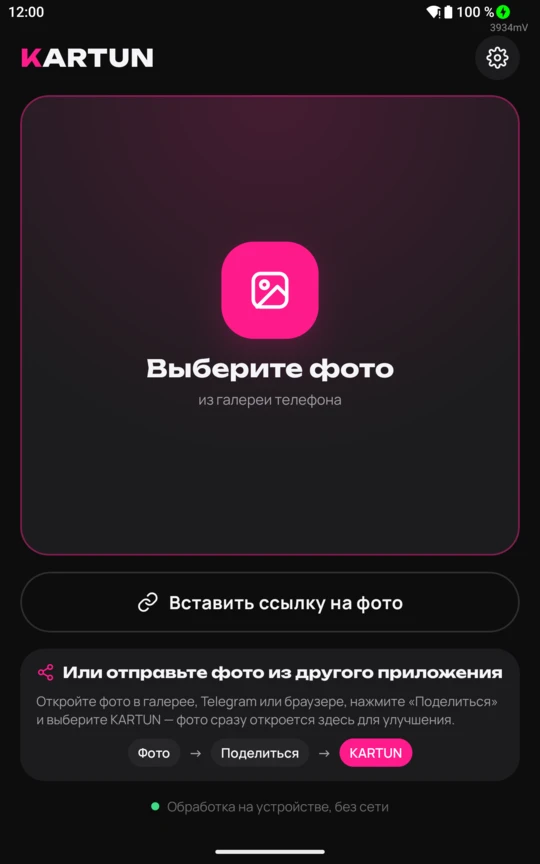
  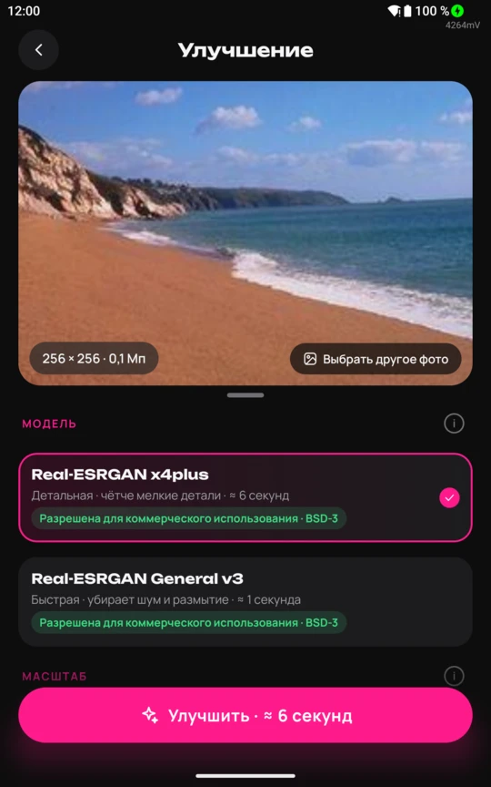
  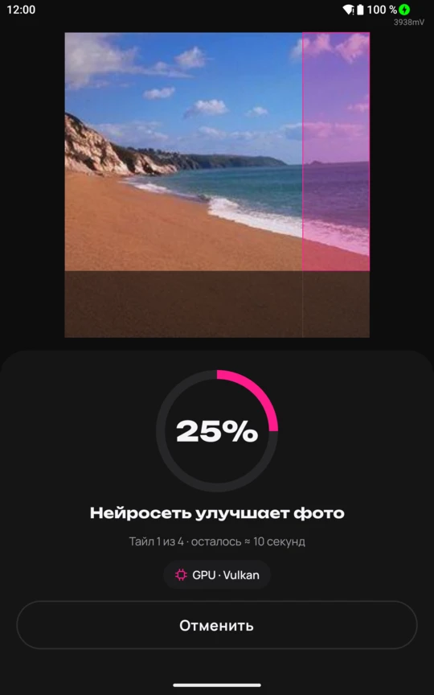
  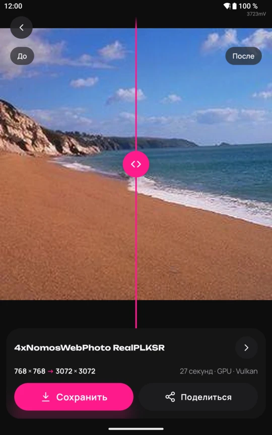
  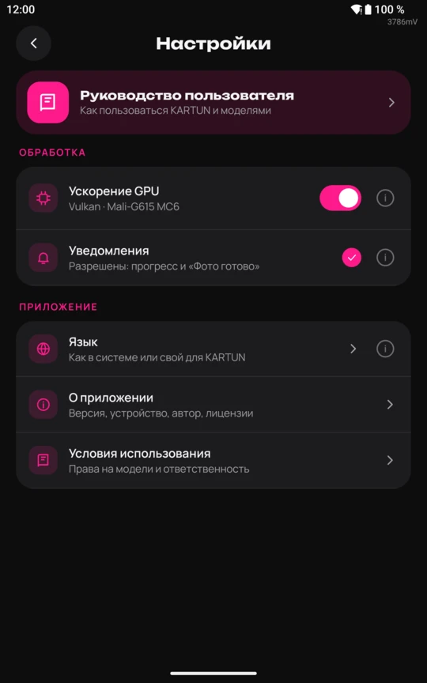
</p>

Разделы: [1 Что умеет](#ru-1) · [2 Экраны](#ru-2) · [3 Модели и скорость](#ru-3) · [4 Приватность](#ru-4) · [5 Форматы и ограничения](#ru-5) · [6 Сборка](#ru-6) · [7 Карта проекта](#ru-7) · [8 Состояние и планы](#ru-8) · [9 Благодарности и лицензия](#ru-9).

<a name="ru-1"></a>
### 1. Что умеет

1. Увеличивает фото в 1×, 2×, 4×, 8× или 16× нейросетью Real-ESRGAN. Нейросеть восстанавливает то, чего нет при
   обычном растяжении: края, фактуру, мелкий текст.
2. Берёт фото тремя путями: из галереи, из меню «Поделиться» любого приложения (Telegram, галерея, браузер) или по
   ссылке — из буфера обмена или набранной вручную.
3. Оценивает время до запуска и показывает ход работы кольцом процентов поверх настоящих тайлов фото. Оценка учится на
   прогонах вашего устройства.
4. Продолжает работу, когда вы выходите из приложения: прогресс и «Отменить» остаются в уведомлении, по готовности
   приходит «Фото готово».
5. Сравнивает «до» и «после» на весь экран: тяните розовую линию, двигайте фото пальцем, двойное касание увеличивает,
   двумя пальцами — ещё крупнее. Панель с кнопками уезжает за край экрана.
6. Сохраняет в `Pictures/KARTUN` в PNG, JPEG или WebP с ползунком качества, всегда новым файлом, или отправляет
   результат через системное меню «Поделиться».
7. Говорит на десяти языках: английском, русском, испанском, португальском, французском, немецком, китайском, хинди,
   бенгальском, арабском. Язык берётся из системы или выбирается только для KARTUN.
8. Работает в портретной и альбомной ориентации; у каждой настройки есть кнопка (i) с коротким пояснением, руководство
   пользователя встроено.
9. Принимает задания от ИИ-агентов с компьютера по adb: команда `node tools/kartun-cli.mjs upscale photo.jpg` отправляет
   фото на устройство и возвращает результат на компьютер. KARTUN при этом может быть закрыт. Команды и JSON-ответы
   описаны в [docs/agent-api.md](docs/agent-api.md).

<a name="ru-2"></a>
### 2. Экраны

| Экран | Что здесь делают |
|---|---|
| Главный | выбирают фото, вставляют ссылку или читают, как отправить фото из другого приложения |
| «Улучшение» | видят фото и его размер, выбирают модель и масштаб, запускают; свайп вверх сворачивает фото в строку, хендл вниз раскрывает его на весь экран |
| Обработка | следят за кольцом и тайлами, видят, сколько прошло и сколько осталось, могут отменить |
| Результат | сравнивают «до» и «после», сохраняют, делятся |
| Настройки | ускорение GPU, уведомления, язык, руководство пользователя, «О приложении» с устройством, автором и лицензиями, условия использования |

<p align="center">
  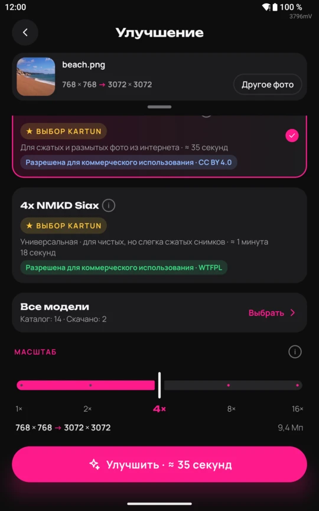
  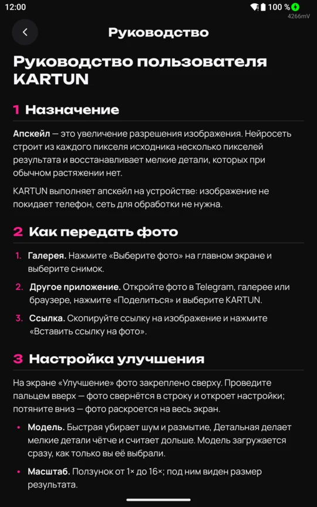
  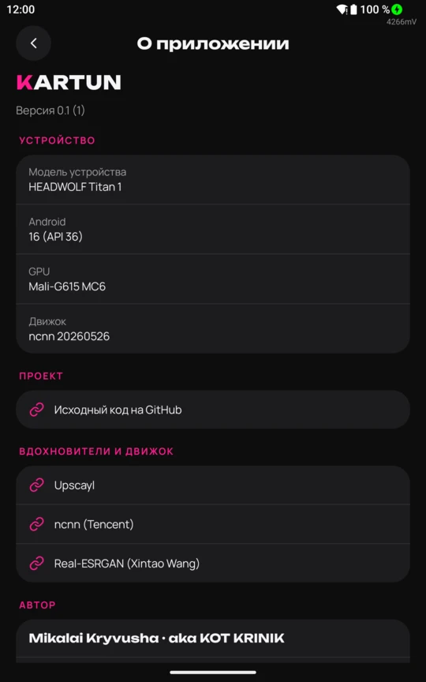
</p>

<a name="ru-3"></a>
### 3. Модели и скорость

В приложение встроены две модели, они работают без сети:

| Модель | Для чего | Лицензия | 256 × 256 → 1024 × 1024 |
|---|---|---|---|
| 4xNomosWebPhoto RealPLKSR, автор Philip Hofmann (по умолчанию) | фото из интернета: сжатие и размытие | CC BY 4.0 | 4,3 с |
| 4x NMKD Siax, автор NMKD | универсальная: чистые и слегка сжатые снимки | WTFPL | 6,9 с |

Ещё двенадцать скачиваются в приложении на экране «Все модели», у каждой — пример «до/после», автор, лицензия и размер:
Real-ESRGAN General v3, x4plus, x4plus anime и AnimeVideo v3, 4xNomos8kSC, 4xHFA2k,
NMKD Superscale, ClearReality V1, Remacri, UltraMix Balanced, UltraSharp V2 Lite и UltraSharp V2. Файлы лежат в
[релизе models](https://github.com/MikalaiKryvusha/KARTUN/releases/tag/models) этого репозитория, приложение сверяет
SHA-256 каждого файла перед работой. Модели принадлежат их авторам; лицензии и источники —
[docs/model-licenses.md](docs/model-licenses.md).

Замер на планшете HEADWOLF Titan 1: MediaTek MT8792, графика Mali-G615 MC6, Vulkan 1.3, Android 16. Фото 960 × 1280,
увеличенное в 8 раз моделью ClearReality V1, считается 25 с.

KARTUN запускает и трансформер: 4x UltraSharp V2 автора Kim2091, сеть DAT2, целиком работает на видеочипе через Vulkan.
Её результат отличается от оригинальной нейросети PyTorch на 66,6 дБ PSNR; фото 960 × 1280 считается около 29 минут.
По дороге мы нашли в шейдере внимания ncnn чтение за краем буфера и отправили исправление в ncnn
([Tencent/ncnn#7121](https://github.com/Tencent/ncnn/pull/7121)).

<a name="ru-4"></a>
### 4. Приватность

1. Нейросеть работает на устройстве. Фото никуда не загружается.
2. Разрешение на сеть нужно для одного: скачать картинку по ссылке, которую вы вставили.
3. Нет аккаунта, рекламы, аналитики и телеметрии.
4. Оригинал не меняется: каждый результат — новый файл.

<a name="ru-5"></a>
### 5. Форматы и ограничения

| | |
|---|---|
| Вход | всё, что открывает сам Android (JPEG, PNG, WebP, HEIC, AVIF, GIF, BMP, ICO), а также TGA, PSD, PPM/PGM, HDR, QOI и TIFF |
| Выход | PNG без потерь, JPEG и WebP с ползунком качества; результат шире 16 383 точек для WebP или 65 500 для JPEG KARTUN предлагает уменьшить до допустимого размера |
| Самое большое исходное фото | 200 Мп |
| Самый большой результат | 536 Мп |
| 8× и 16× | два прохода нейросети: в 4–16 раз дольше, чем 2×–4× |
| Переводы | английский и русский написаны руками; остальные восемь — переводы ИИ, проверенные автором |

<a name="ru-6"></a>
### 6. Сборка

Готовых APK пока нет; соберите приложение из исходников под Windows. Нужны JDK 21, Android SDK с платформой 36,
NDK `29.0.14206865` и CMake `3.31.6`, Node.js и Python 3.

```powershell
git clone https://github.com/MikalaiKryvusha/KARTUN.git
cd KARTUN
node tools/fetch-ncnn.mjs                     # ncnn 20260526 для Android с Vulkan, со сверкой хеша
```

Положите на место две модели (источники и хеши — в [docs/model-licenses.md](docs/model-licenses.md)):

1. Скачайте `realesrgan-ncnn-vulkan-20220424-windows.zip` из
   [релиза Real-ESRGAN v0.2.5.0](https://github.com/xinntao/Real-ESRGAN/releases/tag/v0.2.5.0) и распакуйте в
   `engine/third_party/realesrgan-win/`.
2. Скачайте `realesr-general-x4v3.pth` из того же релиза в `engine/third_party/` и сконвертируйте (Python с `torch`,
   `pnnx` и `numpy`):
   `python -I tools/convert-model.py engine/third_party/realesr-general-x4v3.pth engine/third_party/converted`

```powershell
node tools/stage-models.mjs                   # кладёт модели в APK и сверяет каждый хеш
.\gradlew.bat assembleDebug                   # app/build/outputs/apk/debug/app-debug.apk
```

<a name="ru-7"></a>
### 7. Карта проекта

| Путь | Что там |
|---|---|
| `app/` | Android-приложение: Kotlin, Jetpack Compose, экраны, фоновая служба, сохранение и «Поделиться» |
| `engine/` | нативный движок: C++ поверх ncnn за одной границей JNI, тайлы, Vulkan с запасным путём на процессоре |
| `tools/` | помощники сборки и проверки: загрузка ncnn, конвертация и раскладка моделей, переводы, иконка, прогоны на устройстве |
| `docs/` | лицензии всего, что едет в приложении, происхождение моделей, скриншоты README |
| `design/` | исходники иконки и макеты экранов |

<a name="ru-8"></a>
### 8. Состояние и планы

Ранняя разработка: весь основной путь работает на настоящем устройстве, публичного релиза пока нет. Дальше — каталог
моделей со скачиванием и картинками-превью, запись очень больших результатов полосами, релиз на GitHub. Дорожная
карта — [MASTER_PLAN.md](MASTER_PLAN.md), текущее состояние — [STATUS.md](STATUS.md).

<a name="ru-9"></a>
### 9. Благодарности и лицензия

1. [Upscayl](https://github.com/upscayl/upscayl) — настольное приложение, простоте которого следует KARTUN. Код Upscayl
   не используется: движок KARTUN написан с нуля.
2. [Real-ESRGAN](https://github.com/xinntao/Real-ESRGAN) — модели, автор Xintao Wang (BSD-3).
3. [ncnn](https://github.com/Tencent/ncnn) — движок нейросетей от Tencent (BSD-3).
4. [Unbounded](https://fonts.google.com/specimen/Unbounded) и [Manrope](https://fonts.google.com/specimen/Manrope) —
   шрифты (SIL Open Font License 1.1).
5. KARTUN распространяется по лицензии MIT ([LICENSE](LICENSE)); всё, что едет в приложении, перечислено в
   [docs/THIRD_PARTY.md](docs/THIRD_PARTY.md). Проект ведётся по [KAIF](https://github.com/MikalaiKryvusha/KAIF) —
   фреймворку работы с ИИ-агентом.

Автор: Николай Кривуша (Krinik).
